# Yume Studio ♫

Мобильная студия звукозаписи для Android 16 в духе GarageBand: пастельный аниме-стиль,
живые инструменты, педалборд, многодорожечный секвенсор и микшер.

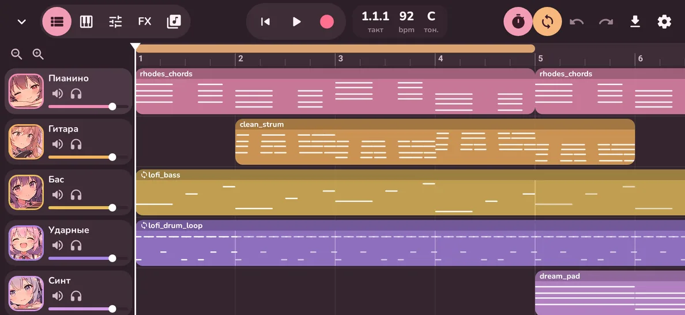

| | |
|---|---|
| 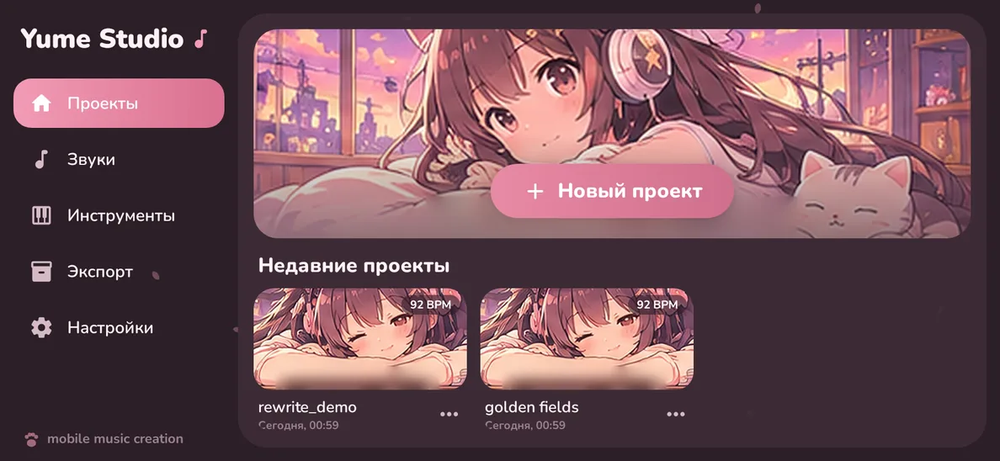 | 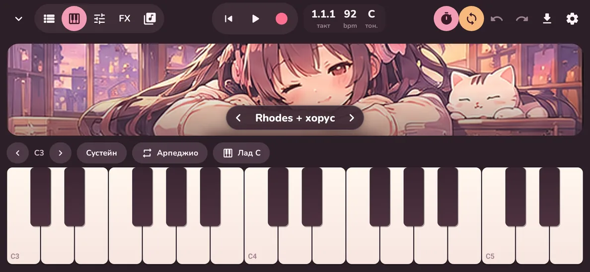 |
| 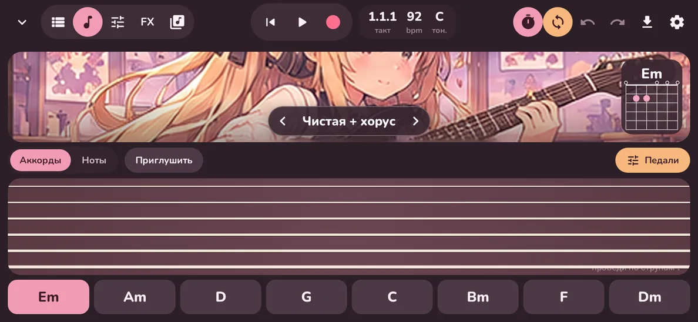 | 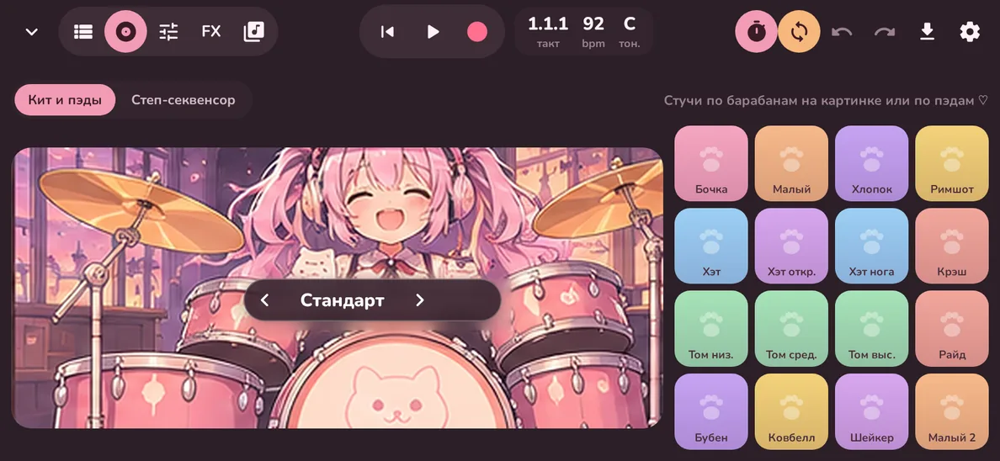 |
| 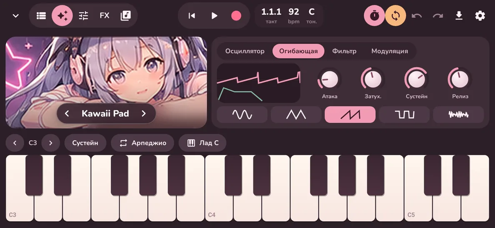 | 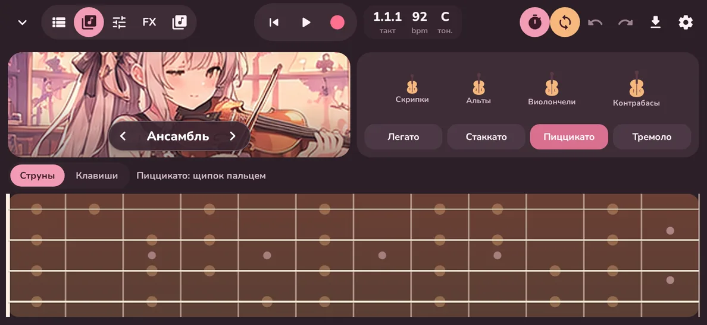 |
| 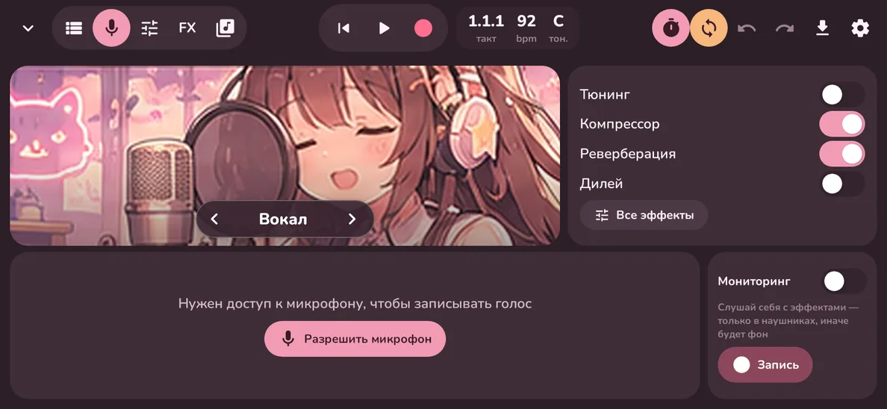 | 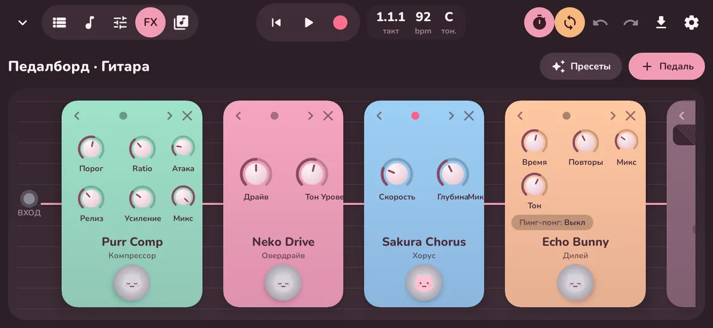 |
| 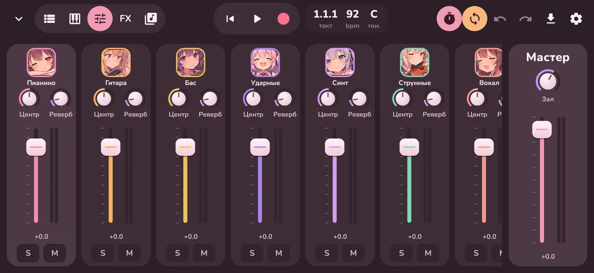 | 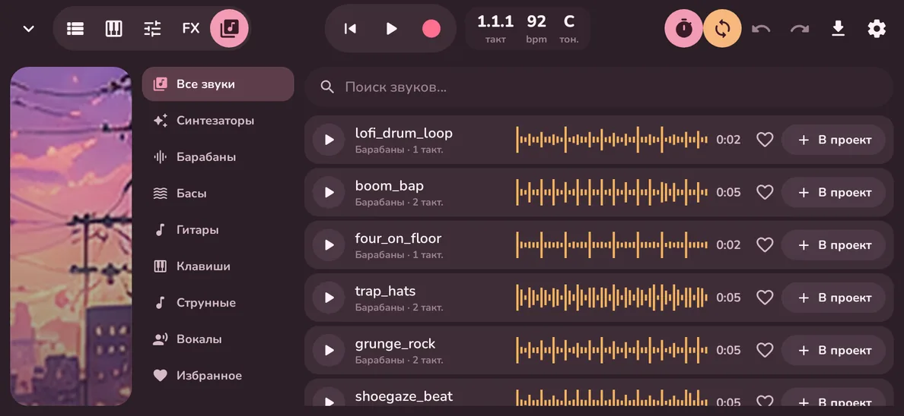 |

## Что умеет

**Инструменты** (звук — General MIDI SoundFont *GeneralUser GS*, 261 пресет + 13 драм-китов):
- **Клавиши** — 47 звуков (рояль, Rhodes, FM-пиано, орган, челеста, шкатулка, хор, флейты,
  кото, калимба, пэды…), мультитач, глиссандо, сила нажатия по высоте касания, сустейн,
  подсветка лада, арпеджиатор (1/8, 1/8т, 1/16, 1/32; вверх/вниз/вверх-вниз/случайно, 1–3 октавы).
- **Гитара** — 16 звуков; режим «Аккорды» (8 аккордов под тональность проекта, страм вниз/вверх,
  свайп по струнам, приглушённый страм, диаграмма аккорда) и режим «Ноты» (гриф, слайды, бенды).
- **Бас** — 11 звуков, гриф на 4 струны, слайды и бенды.
- **Ударные** — 12 китов (включая 808/909, щётки, Electronic): кликабельный кит прямо на арте,
  16 пэдов с силой удара, **степ-секвенсор** 8×16 со свингом и вставкой паттерна в проект.
- **Синтезатор** — собственный субтрактивный синт: 2 осциллятора (синус/треугольник/пила/квадрат/шум),
  унисон, глайд, моно-режим, SVF-фильтр с огибающей, ADSR, LFO; 12 пресетов (Kawaii Pad, Pluck,
  Supersaw, Hyperpop Lead, Shoegaze Wall…).
- **Струнные** — скрипки, альты, виолончели, контрабасы, ансамбли; артикуляции легато / стаккато /
  пиццикато / тремоло; играть на «струнах» или на клавишах.
- **Вокал** — запись с микрофона (или линейного входа), мониторинг в наушниках с эффектами,
  тумблеры «Тюнинг / Компрессор / Реверберация / Дилей», как на макете.

**Педалборд** — до 8 эффектов на дорожку, порядок меняется стрелками, у каждой педали — крутилки и
футсвитч-котик: Purr Comp (компрессор), Hush Gate, Neko Drive (овердрайв), Kitsune Dist (дисторшн),
Mochi Fuzz, Nyaa Wah (ручной/авто), Sakura Chorus, Comet Flanger, Moon Phaser, Heartbeat (тремоло),
Twin Octave, Echo Bunny (дилей с пинг-понгом), Cloud Verb, Lo-Fi Kitty (биткрашер + «кассета»),
Pastel EQ, Yume Amp (Clean / Crunch / Lead / Bass + кабинет), Idol Tune (коррекция высоты по ладу).
Пресеты бордов: City pop clean, Shoegaze dream, Grunge 1991, Lo-fi Kitty, Funky wah, Hyperpop crush,
и вокальные Idol pop / Bedroom / Hyperpop.

**Студия**
- Дорожки: регионы с мини-нотами или волной, перетаскивание между дорожками, подрезка краёв,
  зацикливание, дублирование, разрезание по плейхеду, квантайз (вкл. свинг), зум щипком.
- Запись MIDI и аудио с отсчётом (0–2 такта), метроном, цикл (перетаскивается на линейке).
- Пианоролл: рисование, перемещение, длина, сила нажатия, транспонирование, квантайз.
- Микшер: громкость, панорама, посыл на общий реверб, Solo/Mute, стерео-метры, мастер с лимитером.
- Библиотека: 30+ лупов (барабаны, басы, гитары, клавиши, синты, струнные, вокальные чопы) —
  это MIDI-паттерны, поэтому всегда в темпе и тональности проекта; поиск, избранное, превью.
- Темп (тап-темп), размер, тональность, длина песни; undo/redo; автосохранение.
- Экспорт в WAV 16/24 бит (в «Музыка/YumeStudio» + «Поделиться»), импорт mp3/m4a/ogg/flac/wav,
  проекты целиком в `.yume` (zip) — сохранить и открыть.
- Темы «Сумерки» (как на макете) и «Сакура», лепестки сакуры на главном экране.

**Android 16**: `targetSdk 36`, edge-to-edge, predictive back, тематическая (monochrome) иконка,
нативные библиотеки выровнены под страницы 16 КБ, адаптивная вёрстка (на планшетах Android 16
игнорирует блокировку ориентации).

## Как устроено

```
app/src/main/cpp/           нативный аудиодвижок (C++17)
  engine/Engine.*           дорожки, секвенсор (сэмпл-точный, блоки по 64 сэмпла), транспорт,
                            цикл, метроном, арпеджиатор, запись, микшер, реверб-шина, лимитер,
                            офлайн-рендер в WAV; общение с UI — lock-free очереди команд
  engine/AudioHost.*        Oboe: low-latency выход 48 кГц + вход для записи/мониторинга
  dsp/Effects.*             все эффекты и амп
  instruments/Synth.*       субтрактивный синтезатор
  third_party/tsf.h         TinySoundFont (MIT)
app/src/main/java/com/yume/studio/
  audio/                    JNI-обёртка, каталоги звуков/эффектов, синхронизация проекта с движком
  model/, data/             проект (kotlinx.serialization), хранилище, библиотека лупов, импорт/экспорт
  ui/                       Jetpack Compose: home, studio, tracks, instruments, fx, mixer, editor, library
tools/crop_art.py           нарезка арта из макета art/mockup.png
tools/host-test/            тест движка на хосте (рендер в WAV, ASan/UBSan)
```

## Сборка

Нужны JDK 17+, Android SDK (platform 36, build-tools 36), NDK 28.2.13676358 и CMake 3.31.6
(Android Studio поставит их сама).

```bash
./gradlew assembleDebug          # app/build/outputs/apk/debug/app-debug.apk
./gradlew assembleRelease        # release, подписан debug-ключом — удобно ставить на свой телефон
./gradlew testDebugUnitTest      # юнит-тесты + скриншоты экранов в app/build/screenshots/
```

Тест движка без Android:

```bash
cmake -S tools/host-test -B build/host-test && cmake --build build/host-test
build/host-test/engine_test app/src/main/assets/soundfonts/GeneralUser-GS.sf2 /tmp
```

Арт персонажей вырезан из макета (`art/mockup.png`) скриптом `tools/crop_art.py`; чтобы поставить
картинки получше, положите файлы с теми же именами в `app/src/main/res/drawable-nodpi/`.

## Лицензии

- Звуки: GeneralUser GS © S. Christian Collins — `app/src/main/assets/soundfonts/GeneralUser-GS-LICENSE.txt`
- TinySoundFont © Bernhard Schelling, MIT — `app/src/main/assets/licenses/TinySoundFont-MIT.txt`
- Шрифт Nunito, SIL OFL 1.1 — `app/src/main/assets/licenses/Nunito-OFL.txt`
- Oboe © Google, Apache 2.0
